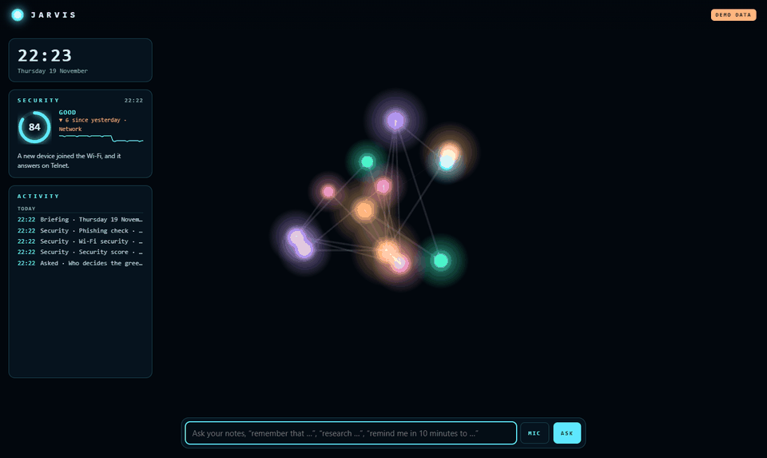

# Jarvis Galaxy

**I built my own Jarvis — and locked it down like a vault.**

A voice-driven personal AI butler for Windows, with a 3D galaxy of your notes as its brain and security designed in from the first line.



<sub>Demo mode, on a made-up coffee roaster. Everything you see runs on your own PC, behind your own lock.</sub>

## What it does

- **A galaxy of your notes.** Every Markdown note is a glowing star, linked by `[[wikilinks]]` and shared ideas. Ask a question and the notes the answer came from light up.
- **A butler you can talk to.** Type or speak; it answers aloud, dry and polite, from your own notes.
- **"Remember that…"** files a new note and links it into the galaxy.
- **Live web research** with its sources in a side drawer.
- **Reminders**, spoken in the HUD or shown as a Windows notification.
- **Expert and lab mode** for technical answers and CTF-style walkthroughs on machines you're allowed to test.
- **Private mode**: answers from a local model on your PC; nothing leaves it.
- **Demo mode** on a made-up company, to look around before connecting anything.

## Optional modules

Off until you switch them on in `config.json`.

- **[Security](docs/modules/security.md)**: a security score gauge in the HUD; checks of your PC, Wi-Fi, connections, network devices and open ports; phishing-link, leaked-password and file checks; alerts from Windows' own logs; and tripwire decoy files that tell you when someone snoops.
- **[OSINT](docs/modules/osint.md)**: passive domain and IP recon (registration, DNS, certificates, who runs it, public threat reports), and a metadata check before you share a photo or PDF.
- **[Workspace](docs/modules/workspace.md)**: Gmail triage, today's Google and Apple calendars, and a spoken morning briefing. Read-only; message bodies are never read.
- **[Phone](docs/modules/phone.md)**: security alerts pushed to your phone with no details in them; Jarvis itself stays unreachable.

Optional packages for those modules: `pip install -r requirements-optional.txt` (only what you need).

## Locked down

- Password + authenticator code before anything works; one-time codes, lockout, idle timeout, recovery codes.
- Listens on 127.0.0.1 only; host and origin checks; a strict Content-Security-Policy; pinned, hash-checked libraries.
- Everything it stores is encrypted with your Windows login.
- More in [docs/security.md](docs/security.md).

## Quick start

You need **Windows 10/11**, **Python 3.11+**, **Claude Code** logged in to your own Claude account, an **authenticator app** on your phone, and **Chrome or Edge**.

```powershell
git clone https://github.com/Anikan09/jarvis-galaxy
cd jarvis-galaxy
python setup.py            # checks, config, notes folder, and the lock
python -m core.server      # then open http://localhost:4747
```

Or look around first: `python -m core.server --demo`. Full steps: [docs/setup.md](docs/setup.md).

**You need your own Claude account.** The brain is the [Claude Code](https://docs.claude.com/en/docs/claude-code) CLI, running on your subscription. Nothing is shared or proxied.

No third-party Python packages: the core is standard library only.

## Docs

[Setup](docs/setup.md) · [FAQ](docs/FAQ.md) · [Configuration](docs/configuration.md) · [Security design](docs/security.md) · [Private brain](docs/private-brain.md) · [Security](docs/modules/security.md) · [OSINT](docs/modules/osint.md) · [Workspace](docs/modules/workspace.md) · [Phone](docs/modules/phone.md) · [Design](docs/DESIGN.md) · [How I built it](docs/how-i-built-it.md)

## Credits

The 3D galaxy uses [three.js](https://threejs.org) and [3d-force-graph](https://github.com/vasturiano/3d-force-graph), both MIT-licensed, loaded from jsdelivr with pinned integrity hashes.

Some feature ideas, like the notes galaxy, the voice and flying to a note's source, were inspired by [zubair-trabzada](https://github.com/zubair-trabzada)'s Claude projects and his community, [AI Workshop](https://www.skool.com/aiworkshop-lite). The code here is written from scratch.

---

Not affiliated with Marvel; "Jarvis" is used as a generic word for a butler AI. Released under the [MIT License](LICENSE).
